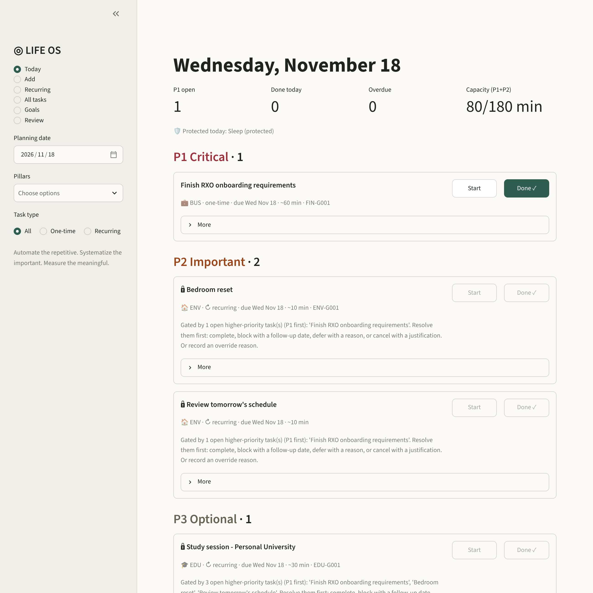

# LIFE OS

Personal governance, execution and accountability system built on the **Five Pillars** —
Business · Relationships · Environment · Finances · Education.

> Automate the repetitive. Systematize the important. Measure the meaningful.
> Preserve human judgment. Continuously improve.

**Current milestone:** 1 — Foundation & Daily Execution ([design + test matrix](docs/milestone-1.md)).



## What it does today

- One-time and recurring tasks in a single P1 → P2 → P3 queue.
- **Priority Assurance Framework:** lower-priority work is gated until higher-priority work is resolved, and every gate explains itself. Overrides are allowed but always recorded.
- Protected commitments (sleep, shifts) are never gated.
- Dependencies (with cycle protection), required evidence, and a full audit history for every task.
- A daily plan with overdue items (never silently dropped), capacity/overcommitment warnings and follow-ups.
- An end-of-day review and constructive pattern detection: repeated rescheduling, weak routine adherence, P1 downgrades.
- **Planning cascade:** 3-5 yr Vision ← 6-12 mo Goals ← 3 mo Objectives ← daily/weekly Key Results ← tasks.
  Progress flows up the chain, and gaps in it are flagged.
- **Countdowns and timelines:** every vision, goal and objective has a deadline that counts down. Deadlines only
  move with a recorded reason, and each goal shows its quarter-by-quarter runway.
- **Planner:** Agenda / Week / Month views, class schedules, calendar (.ics) import from Canvas or Google,
  "plan the week", and a Sunday weekly review with a scorecard and next week's top 3 ([details](docs/planner.md)).
- **Weekly outcomes and the evening check:** up to 3 finish lines a week, closed with evidence. Three evening
  questions (progress, one ask, capacity) plan tomorrow, and capacity follows your real calendar, overnights
  included ([plan](docs/plan-reviews-decisions.md)).
- **Money:** separate tabs for family, holidays, wants, reserves and money owed. Fill-up bars, a 14-day cool-off
  on wants, "Before you buy" (price in hours of work), and a paycheck splitter that funds obligations first
  ([details](docs/money.md)).
- **Deals:** a used-equipment pipeline with risk flags, an inspection checklist, seven purchase gates, ranking,
  and fleet tracking. Purchases never touch protected reserves ([details](docs/deals.md)).
- **Tasks by pillar:** All tasks opens grouped by pillar, then overdue / this week / later / no date / waiting,
  with a side-by-side Board view.
- **Edit anything:** one ✏️ form per task or routine. The audit rules still apply, and a reason is asked for
  only where it matters.
- **Plan files:** load a whole vision-to-tasks plan from YAML in one step ([format](docs/plan-files.md)).
  Plan files stay in your git-ignored `data/` folder.

## Quick start

```bash
python3 -m venv .venv && source .venv/bin/activate
pip install -e ".[dev]"

lifeos seed        # creates data/lifeos.db with your starter goals, tasks and routines
lifeos today       # text version of today's command center
lifeos dashboard   # opens the Streamlit dashboard at http://localhost:8501
pytest             # run the test suite
```

Your data lives in `data/lifeos.db`, which is **git-ignored**. Back it up yourself.
Point at another database with `LIFEOS_DB=/path/to/file.db`.

## Layout

```
lifeos/engines/    pure rules: state machine, priority gate, recurrence, dependencies
lifeos/services/   every write goes through here (validation + audit trail)
lifeos/dashboard/  Streamlit UI (no business logic)
config/            pillars and behavior settings (capacity, thresholds, timezone)
seed/              starter goals/tasks/routines (no financial figures)
tests/             unit, integration, adversarial, UI smoke tests
docs/              milestone designs and acceptance matrices
```

## Roadmap

1. ✅ Foundation & daily execution
2. Financial recovery: accounts, obligations, buckets, forecasts, FIN-C001..C010 controls
3. Five-Pillar reporting
4. AI Life Assurance Agent (works inside the controls, never around them)
5. Jet Life acquisition intelligence (✅ Deals) + Personal University
6. Continuous assurance and optimization
